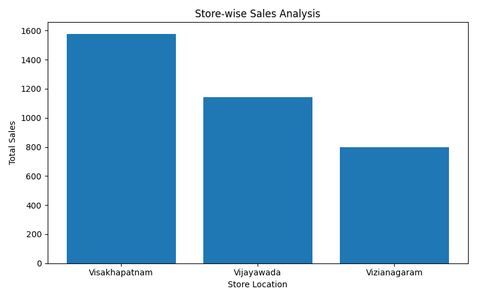
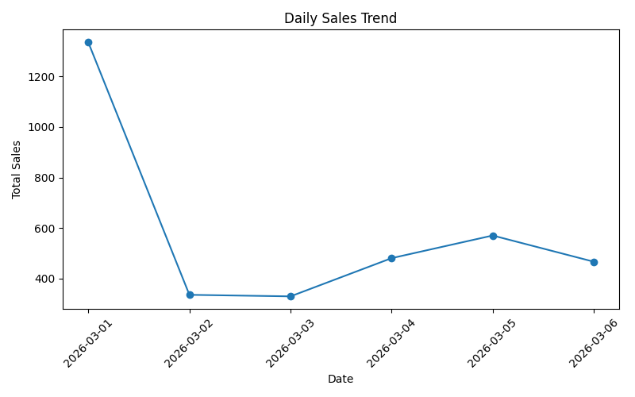
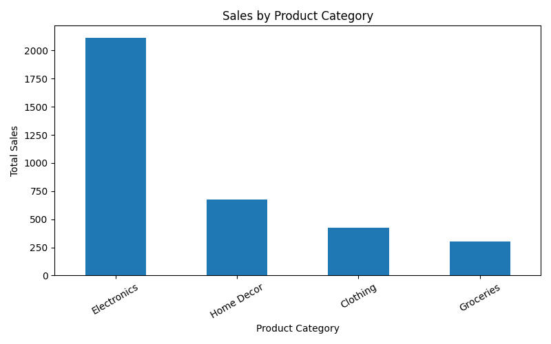
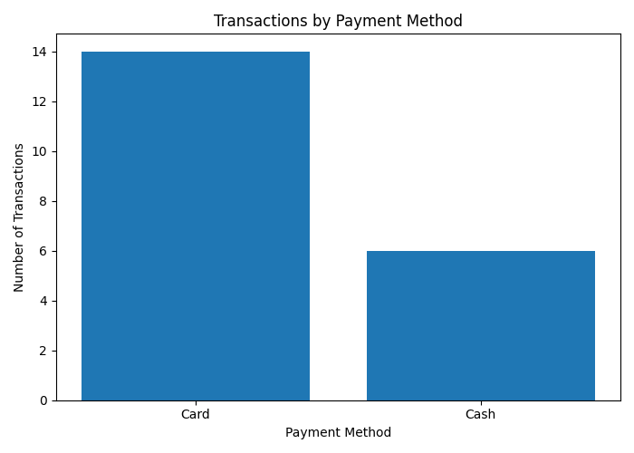

# Retail Transaction Analysis

## Project Overview
This project analyzes retail transaction data to understand sales performance across cities, product categories, dates, and payment methods.

The project uses synthetic sample data for demonstration and learning purposes.

## Tools and Technologies
- Python
- SQL (SQLite)
- Pandas
- Matplotlib
- CSV

## Project Objectives
- Analyze total sales by city.
- Identify sales trends over time.
- Compare sales across product categories.
- Analyze payment method usage.
- Identify potential duplicate records.
- Clean transaction data and export the cleaned dataset.

## Project Workflow
1. Create a SQLite database containing sample retail transactions.
2. Analyze the data using SQL queries.
3. Identify and remove potential duplicate records using Pandas.
4. Calculate city-wise and category-wise sales.
5. Generate graphs using Matplotlib.
6. Export the cleaned data to CSV.


### Visualizations

 1. City-wise Sales Analysis


 2. Daily Sales Trend


 3. Sales by Product Category


 4. Transactions by Payment Method



## Project Files
- `setup_database.py` — Creates and populates the database.
- `analysis.py` — Performs SQL analysis and data cleaning.
- `analysis_queries.sql` — Contains 10 SQL analysis queries.
- `run_sql_queries.py` — Executes the SQL queries.
- `create_graphs.py` — Generates three graphs.
- `retail_store.db` — SQLite database.
- `cleaned_transactions.csv` — Cleaned transaction dataset.
- `store_sales_chart.png` — City-wise sales chart.
- `daily_sales_trend.png` — Daily sales trend.
- `category_sales.png` — Category sales chart.
- `payment_method_analysis.png` — Payment method chart.

## Key Findings
- Visakhapatnam recorded the highest city-wise sales in the cleaned sample dataset.
- Sales varied across the six days represented in the dataset.
- Product categories can be compared by their total sales.
- Payment methods can be compared by transaction count.

## How to Run
Run these commands from the project folder:

```bash
python setup_database.py
python analysis.py
python create_graphs.py
python run_sql_queries.py
```

## Note
This project uses synthetic sample transactions. The results do not represent actual retail business sales.
